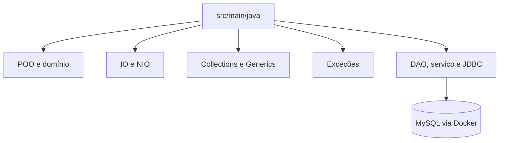

# Aprofundando POO em Java

Caderno de estudos práticos sobre Java, orientação a objetos e APIs da
plataforma. O repositório reúne exercícios independentes, exemplos de cursos e
pequenos experimentos com banco de dados, arquivos, coleções e tratamento de
exceções.

## Problema resolvido

Transformar conceitos isolados da linguagem em exemplos executáveis e
comparáveis. Cada pacote explora uma capacidade específica, permitindo estudar
uma solução sem depender de uma aplicação monolítica única.

## Arquitetura do material



Pacotes relevantes incluem `classesabstratas`, `interfaces`, `heranca`,
`polimorfismo`, `encapsulamento`, `enumeradores`, `genericss`, `colecoes`,
`arquivos`, `pacoteNIO`, `excessoes`, `estruturasdados` e `db`.

## Tecnologias

- Java 21;
- Maven;
- MySQL Connector/J 8.4.0;
- Lombok 1.18.38 em alguns exemplos;
- Log4j 2.25.3;
- Docker Compose com MySQL 8.4.0 para os exemplos de banco.

## Como executar

Compile os exemplos com Maven:

```bash
mvn test
```

Para os exemplos que usam banco, inicie o MySQL:

```bash
docker compose up -d
```

Revise a configuração de conexão antes de executar classes do pacote `db`.
O Compose atual usa o banco `anime_store` e mantém dados em volume nomeado.

Como os arquivos são exemplos independentes, a execução de um caso específico
depende da classe que contém o método `main`. A configuração do IDE pode ser
mais conveniente para explorar os pacotes individualmente.

## Testes realizados

O projeto possui `pom.xml`, mas não possui arquivos em `src/test`; portanto,
`mvn test` valida principalmente compilação e ciclo Maven, não regras de negócio
por asserções automatizadas. Os exemplos JDBC exigem MySQL ativo e configuração
compatível.

## Decisões técnicas e escopo

- manter exercícios separados por tema para favorecer aprendizagem incremental;
- usar classes de domínio, repositórios e serviços nos exemplos de persistência;
- manter o banco fora do código por meio do Docker Compose;
- não apresentar os exemplos como uma aplicação pronta para produção: faltam
  contrato único, cobertura automatizada e configuração segura de credenciais.

## Screenshots e diagramas

Não há interface visual. O diagrama acima representa a organização do material;
screenshots não agregariam informação ao projeto atual.
